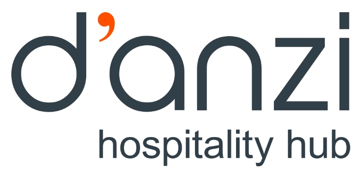
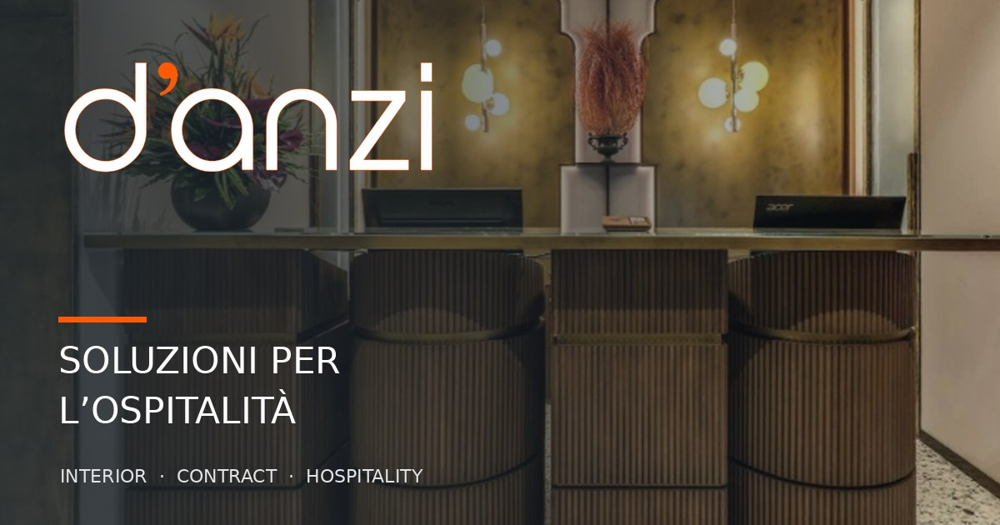

<p align="center">
  
</p>

<h1 align="center">D’Anzi Hospitality Hub</h1>
<p align="center">
  <strong>Soluzioni per un’ospitalità che fa la differenza.</strong><br />
  Prodotti, servizi e consulenza per strutture ricettive, progetti interior e contract.
</p>

<p align="center">
  <a href="https://danzi-hospitality-hub.vercel.app">Anteprima online</a> ·
  <a href="#avvio-rapido">Avvio rapido</a> ·
  <a href="docs/CONTENT_GUIDE.md">Gestione contenuti</a> ·
  <a href="docs/DEPLOYMENT.md">Deploy</a>
</p>

<p align="center">
  
  
  
  
  <a href="https://github.com/Mattia471/danzi-hospitality-hub/actions/workflows/ci.yml"></a>
</p>

<p align="center">
  
</p>

> **Repository del sito aziendale.** Il link Vercel è un ambiente di pubblicazione esistente, non necessariamente il dominio definitivo. Contatti, materiali fotografici, policy e configurazioni operative devono essere confermati prima del rilascio ufficiale.

## Il progetto

D’Anzi Hospitality Hub presenta una realtà familiare romana attiva dal 1975, specializzata nel supportare le strutture ricettive con soluzioni per arredo, benessere, sicurezza, bedding, linee cortesia e hospitality contract.

Il sito è una **SPA responsive** sviluppata in React, senza CMS, database o backend proprietario. I contenuti pubblici sono mantenuti in file TypeScript e i cataloghi PDF opzionali possono essere visualizzati da Google Drive.

### Funzionalità

- **Home editoriale:** hero con slider di realizzazioni, valori, servizi, progetti e network partner.
- **Portfolio fotografico:** progetti, gallery, tipologie d'intervento, località e architetti opzionali.
- **Partner:** nove marchi confermati, mappa Leaflet/OpenStreetMap, siti e indicazioni.
- **Cataloghi PDF:** visualizzazione all'interno del sito mediante preview Google Drive quando sono presenti link approvati.
- **Prodotti e servizi:** sette categorie predisposte per gallery e schede prodotto.
- **Consulenza:** form con validazione frontend, honeypot e endpoint HTTPS configurabile; fallback a client email.
- **Pubblicazione:** meta SEO, Open Graph, sitemap condizionale, favicon e gestione route SPA su Vercel.
- **Responsive:** componenti pensati per desktop, tablet e smartphone.

## Stack tecnico

| Livello | Tecnologie |
| --- | --- |
| UI | React 19, TypeScript, Tailwind CSS 4, Lucide React |
| Build | Vite 8, pnpm |
| Navigazione | React Router 7 |
| Mappe | Leaflet, React Leaflet, OpenStreetMap |
| Cataloghi | Google Drive, iframe di anteprima |
| Form | Endpoint esterno opzionale (es. Formspree), nessun backend proprietario |
| Hosting | Vercel con fallback per SPA |

## Avvio rapido

**Requisiti:** Node.js **20.19+** (consigliato Node 22) e **pnpm 10.28.2**.

```bash
git clone https://github.com/Mattia471/danzi-hospitality-hub.git
cd danzi-hospitality-hub
corepack enable
pnpm install --frozen-lockfile
cp .env.example .env.local
pnpm dev
```

Apri l'indirizzo locale mostrato da Vite.

| Comando | Cosa fa |
| --- | --- |
| `pnpm dev` | Server locale con HMR |
| `pnpm lint` | Controlli ESLint |
| `pnpm build` | TypeScript, build Vite e generazione file SEO |
| `pnpm preview` | Anteprima locale della build |

## Configurazione

Le variabili supportate sono pubbliche e utilizzate dal frontend:

| Variabile | Obbligatoria | Scopo |
| --- | --- | --- |
| `VITE_SITE_URL` | Per SEO di produzione | Origine HTTPS finale, senza percorso o slash terminale |
| `VITE_CONTACT_FORM_ENDPOINT` | Per invio automatico | Endpoint HTTPS del provider del form |

Copia `.env.example` in `.env.local` durante lo sviluppo. Non inserire **password, token privati o chiavi segrete** nelle variabili `VITE_...`: Vite le espone al browser.

Senza endpoint del form si apre il programma di posta del visitatore: **non equivale all'invio automatico**. Con un dominio non impostato, il processo di build non genera la sitemap con URL assoluti.

## Struttura del repository

```text
src/
├── components/
│   ├── home/          # Sezioni Home e form
│   ├── layout/        # Header, footer e shell
│   ├── partners/      # Schede e mappa
│   └── ui/            # Componenti riutilizzabili
├── config/            # Contatti e riferimenti media
├── data/              # Partner, progetti, categorie, PDF
├── pages/             # Pagine e viewer cataloghi
├── routes/            # React Router
└── types/             # Modelli TypeScript
public/
├── brand/             # Loghi ufficiali
├── images/projects/   # Fotografie portfolio
└── og-cover.jpg       # Anteprima social
scripts/generate-seo.mjs
docs/                    # Guide tecniche e operative
```

## Pagine disponibili

| Percorso | Contenuto |
| --- | --- |
| `/` | Home |
| `/chi-siamo` | Storia e valori |
| `/realizzazioni` | Portfolio fotografico |
| `/partner` | Partner e mappa |
| `/partner/:partnerId/cataloghi/:catalogId` | Viewer PDF |
| `/prodotti-e-servizi` | Panoramica |
| `/prodotti-e-servizi/:slug` | Categoria prodotti |
| `*` | Pagina 404 |

## Aggiornare il sito

La maggior parte delle modifiche editoriali richiede soltanto l'aggiornamento dei dati:

| Cosa modificare | Dove |
| --- | --- |
| Partner, descrizioni, indirizzi, assistenza | `src/data/partners.ts` |
| Link PDF su Google Drive | `src/data/partnerCatalogs.ts` |
| Realizzazioni e gallery | `src/data/projects.ts` + `public/images/projects/` |
| Categorie e prodotti | `src/data/productCatalog.ts`, `src/data/services.ts` |
| Contatti e descrizione istituzionale | `src/config/site.ts` |
| Immagine famiglia nella Home | `src/config/media.ts` |
| Logo e favicon | `public/brand/`, `public/favicon-*` |

Leggi la [guida completa ai contenuti](docs/CONTENT_GUIDE.md). **I PDF già associati** possono essere aggiornati dal cliente tramite *Gestisci versioni* su Google Drive, conservando lo stesso ID del file. **Aggiungere nuovi cataloghi** richiede invece aggiornare `partnerCatalogs.ts` e ripubblicare il sito.

## Qualità, deploy e sicurezza

La [CI GitHub Actions](.github/workflows/ci.yml) esegue installazione, lint e build a ogni push e pull request. La pipeline **non sostituisce** un collaudo funzionale in browser.

- [Architettura](docs/ARCHITECTURE.md)
- [Deploy e checklist go-live](docs/DEPLOYMENT.md)
- [Contribuire al progetto](CONTRIBUTING.md)
- [Segnalazioni di sicurezza](SECURITY.md)
- [Titolarità e uso degli asset](NOTICE.md)

**Prima di andare in produzione:** confermare dominio, recapiti, disponibilità dei cataloghi, diritti di utilizzo delle immagini, privacy/cookie e consegna effettiva del form. Mappe e iframe Google Drive comportano richieste a servizi terzi.

## Crediti

**Cliente e brand:** D’Anzi Hospitality Hub  
**Sviluppo web:** [@mattiacucuzza_](https://www.instagram.com/mattiacucuzza_/)

Il codice pubblico e gli asset di brand **non sono automaticamente open source**. Vedi [NOTICE.md](NOTICE.md) per le condizioni d'uso e le attribuzioni.
